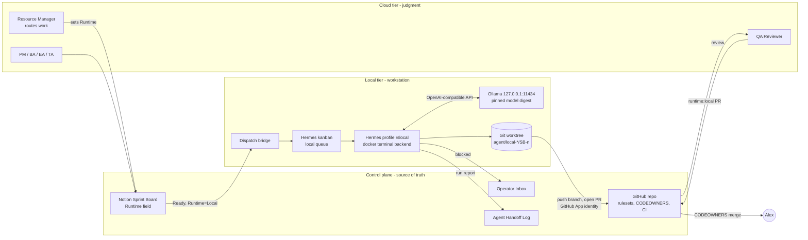

# Hybrid agent runtime: cloud and local agents

Status: Draft, pending [ADR-002](../adr/ADR-002-hybrid-agent-runtime.md) (Proposed).
Setup and operations: [local-agent-setup-and-governance.md](local-agent-setup-and-governance.md).

## 1. Goal

Speed up delivery by sending bounded, checkable work to agents that run on a local workstation (Hermes Agent + Ollama), while the cloud agent team keeps design, review and decision work. Local output enters the project only through the same gates as any other agent work: a branch, a PR, CI, QA review and Alex's merge.

What this design does not change:

- Notion Agent Team HQ and this repository stay the only shared state.
- The story flow, folder ownership, and "only Alex merges / approves ADRs" rules in `AGENTS.md`.
- The runtime-neutral architecture guardrails for the product itself.

## 2. Architecture

### Components

| Component | Runs on | Responsibility | Does not |
|---|---|---|---|
| Sprint Board `Runtime` field | Notion | Says where a story or sub-task runs: `Cloud`, `Local`, `Local + Cloud review` | |
| Resource Manager (cloud) | Claude | Sets `Runtime` using the routing rules in section 3 | Run local work itself |
| Dispatch bridge | Workstation | Copies eligible stories into the Hermes kanban as task cards; writes PR link and run report back | Decide eligibility |
| Hermes Agent, profile `rslocal` | Workstation | Executes a task card in an isolated worktree, inside a Docker sandbox | Hold merge rights, touch other profiles' config |
| Ollama | Workstation, loopback only | Serves the pinned local model through its OpenAI-compatible endpoint | Listen on any network interface |
| GitHub App `rs-local-agent` | GitHub | The only identity local agents push with: contents and pull requests on this repo | Admin, workflows, merge to `main` |
| QA Reviewer (cloud) | Claude | Reviews every `runtime:local` PR against the spec | Push to the local agent's branch |
| CI (`build-smoke-test` + later checks) | GitHub Actions | Deterministic gate | |
| Alex | | Merges, approves ADRs, holds the kill switch | |

### Why this shape

- **Cloud reviews local, never the reverse.** The local model is cheaper and private but weaker. Every local change gets a stronger reviewer plus CI before it reaches `main`. The Hermes kanban's built-in review step can run, but it only advises.
- **Git is the integration bus.** Local agents produce branches and PRs, nothing else. No direct Notion edits to other agents' items, no shared filesystem with cloud agents. This keeps the boundary auditable and runtime-neutral.
- **Least privilege by construction.** The local agent never sees the operator's `gh` login, Claude login, or cloud model keys. It runs in a container that only mounts its own worktree.
- **Notion stays the source of truth.** The Hermes kanban is a local work queue, not a second board. If the two disagree, Notion wins and the bridge reconciles.

## 3. Routing rules (what goes local)

Work is classified by risk tier. A task class runs locally only after it passes the evaluation gate (section 5).

| Tier | Examples | Runtime |
|---|---|---|
| L0 read-only | Summarise CI logs, classify defects, extract fields from public research into a draft, link-check docs, spec-to-checklist conversion | `Local` (output is a comment or attachment, no push) |
| L1 bounded write, deterministic check | Test scaffolding from an Approved-ADR spec, doc formatting, fixture generation, boilerplate from a template, dependency bumps with passing CI | `Local + Cloud review` |
| L2 judgment | Specs, ADRs, requirements, architecture, TOGAF artifacts, security-relevant code, anything in `.github/`, `AGENTS.md`, Alex-owned paths | `Cloud` only |
| L3 never automated | Merges, ADR approval, credentials, account creation, paid services, branch deletion | Alex only |

Rules of thumb for the Resource Manager:

1. A local task card must be completable from the card plus the repo alone: spec link, files in scope, acceptance check command.
2. If no command can tell pass from fail, it is not L1.
3. Client-specific or confidential work never enters this public repo, local or not. A local model reduces data egress; it does not change what may be committed.
4. Two failed local attempts on the same card: route it to `Cloud` and record why in the Handoff Log.

## 4. Integration contract

Every local run produces:

| Artifact | Where | Content |
|---|---|---|
| Branch | `agent/local-<role>/<story-id>` (e.g. `agent/local-developer/SB-14`) | Commits only inside the files listed on the card |
| PR | to `main`, label `runtime:local`, PR template | Story link, acceptance command and its output, **run report** below |
| Run report | PR body section + Handoff Log entry | Hermes version, profile, model name and digest, task card id, start/end time, token usage (`--usage-file`), commands run, result |
| Blocker | Operator Inbox (`From Agent = Local <role>`) | When the card is ambiguous or a check fails twice |

Handoff Log naming: `Run = Local <Role> - YYYY-MM-DD`, with a `Runtime = Local` property so local runs can be filtered and measured.

## 5. Evaluation and promotion

A task class (for example "Apex test class from spec") moves from `Cloud` to `Local + Cloud review` only when:

1. A golden set of at least 10 past tasks of that class exists, with known-good outputs.
2. The local profile passes at least 8 of 10, judged by the acceptance command plus a QA Reviewer rubric.
3. Alex approves the promotion (Decisions Log row).

It is demoted automatically when, over a rolling 20 runs, QA rejects more than 30% or any run violates a governance rule (out-of-scope file, secret in diff, sandbox escape attempt).

Tracked weekly: local PR acceptance rate, QA findings per local PR, median rework cycles, wall-clock per task, cloud tokens saved.

## 6. Capacity and model choice

Reference workstation: 24 GB laptop GPU, 64 GB RAM. The current model (a 74B mixture-of-experts Nemotron build, ~9B active, IQ2_XXS quantisation, 24 GB on disk) does not fit in VRAM with a 64K context and runs about 60/40 CPU/GPU. Implications:

- Expect low tokens/second and one agent at a time. Run local work as an overnight or background queue, not interactive pairing.
- 2-bit quantisation degrades instruction following and tool-call reliability more than it degrades chat quality. The evaluation gate decides, not the parameter count.
- Benchmark a smaller tool-capable model that fits entirely in VRAM at 4-bit as the default worker, and keep the large model for L0 drafting. Pick per task class from evaluation results.
- Pin context deliberately (`ollama_num_ctx` in Hermes): bigger context costs VRAM and pushes more layers to CPU.

## 7. Rollout

| Phase | Scope | Exit criterion |
|---|---|---|
| 0 Harden | Local-only Hermes profile, sandbox, toolset lockdown (guide parts 1-4) | `hermes status` shows local provider; leak checks in guide part 6 pass |
| 1 Shadow | Alex dispatches L0 and L1 cards by hand. Agent works in a worktree; **no push credentials**; Alex reviews the diff and pushes | 20 runs logged, golden sets built for 2 task classes |
| 2 PR flow | GitHub App identity, `runtime:local` PRs, QA Reviewer reviews, Sprint Board `Runtime` field | 2 task classes promoted; acceptance rate ≥ 80% |
| 3 Automated dispatch | Bridge pulls `Runtime = Local` stories into Hermes kanban on a schedule; writes back PR link and Handoff Log | Two weeks with no governance violations |

## 8. Risks

| Risk | Mitigation |
|---|---|
| Silent fallback to a cloud provider sends repo context off-machine | Dedicated profile with no fallback chain; leak check in guide; run report records provider |
| Agent uses operator's credentials (`gh`, Claude login) | Docker backend; `auth.adopt_external_logins: false`; GitHub App token scoped to one repo |
| Headless runs skip approval prompts (`hermes -z` auto-bypasses) | Headless only with Docker backend and narrow toolsets; never `--yolo` interactively |
| Prompt injection via repo or web content | Web, browser and computer-use toolsets off for `rslocal`; CI + cloud review on all output |
| Low-quality output floods review | Evaluation gate, WIP limit of 2 open local PRs, demotion rule |
| Model supply chain | Official library only; pin digest; record licence; `hermes security` audit of plugins and MCP servers |
| Workstation offline | Local tier is an accelerator, never on the critical path; cards time out back to `Cloud` |
